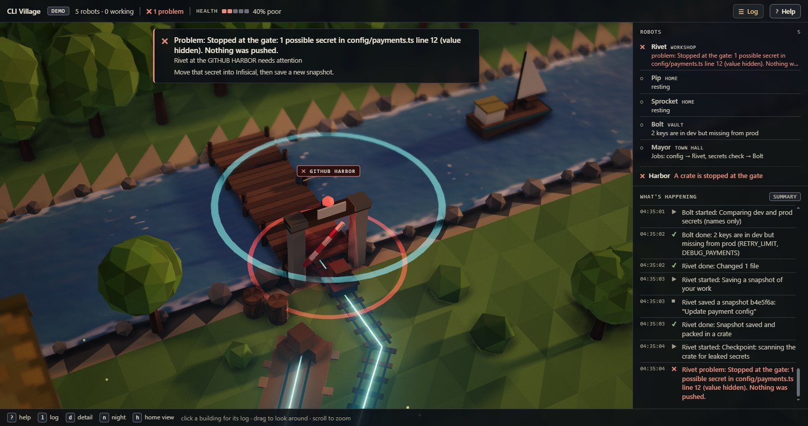
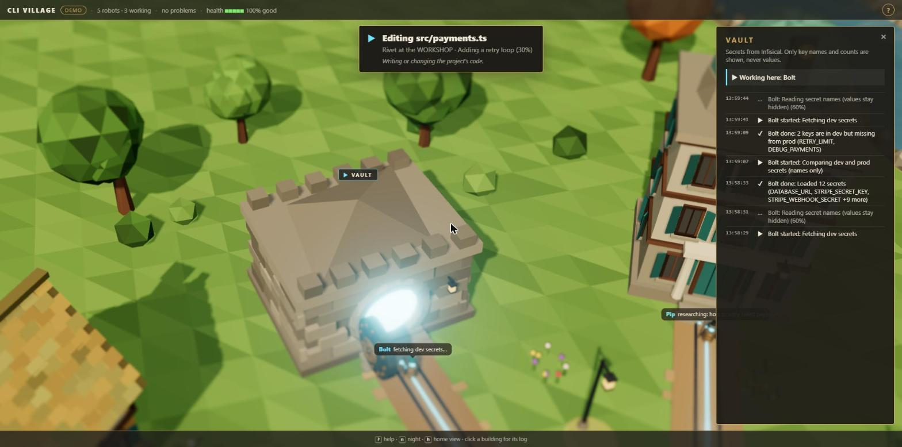
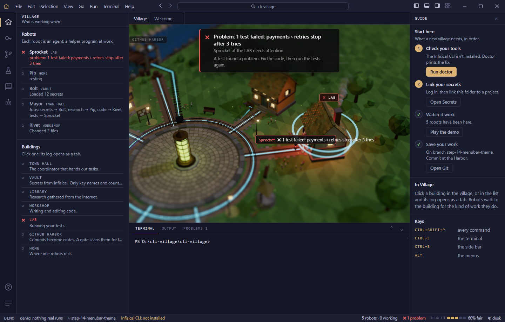

# CLI Village

> Watch your agents work in a tiny low-poly village.

[](https://github.com/GrantVRP/cli-village/actions/workflows/ci.yml) [](https://github.com/GrantVRP/cli-village/actions/workflows/release.yml)

CLI Village is a friendly, open-source wrapper around the [Infisical CLI](https://infisical.com/docs/cli/overview). It keeps everything Infisical does, including its privacy guarantees, and lets you *see* the work happening. Each agent is a little robot, each building is a type of task, and commits get carried down to the GitHub Harbor.

It's made for beginners (every action is explained in plain English, next to the real command) and stays out of the way for experts.

**Status:** early days: version 0.1.0 is the first release. CI builds the installers for Windows, macOS and Linux and opens and tests each one; the Mac and Linux installers haven't been tried by a person yet, so tell us how they go. The desktop app has been tested by hand on Windows, and the secret scan, flags and error messages have been checked against the real Infisical CLI (0.45.13). What hasn't been tried yet: real secrets from a logged-in Infisical account. You can check your setup with `doctor`, work with your real Infisical secrets (`secrets fetch`, `secrets diff`, `secrets export`, `run`), save and send your work with a secret-scan checkpoint (`status`, `commit`, `push`), run your tests (`test`), and watch it all happen in the terminal (`cli-village`), a 3D village in your browser (`cli-village open`) or the desktop app (`cli-village app`). Your AI agents can join in too (`cli-village emit`). No real work to show yet? Try the demo (`--demo`, `open --demo`, `app --demo`).


## What you need

- git
- The Infisical CLI, for secrets and the secret scan (`cli-village doctor` tells you how to install it)
- For the command line from npm, or from source: Node.js 22.12 or newer. The desktop app brings its own.

## Install

Two parts, use either or both:

- **The desktop app** (Windows, macOS, Linux): the village, a terminal and the tools in one window. Its terminal has `cli-village` built in, so it's all you need.
- **The command line** (`npm install -g cli-village`): `cli-village` in any terminal, the terminal view, and the 3D village in your browser.

### The desktop app

Download the file for your computer from the [latest release](https://github.com/GrantVRP/cli-village/releases/latest):

| Computer | File | Then |
|---|---|---|
| Windows | `cli-village-<version>-win-x64.exe` | Run it. It installs for you only (no administrator rights) and adds a Start menu entry. |
| Mac with Apple silicon (M1 and newer) | `cli-village-<version>-mac-arm64.dmg` | Open it and drag CLI Village to Applications. |
| Mac with Intel | `cli-village-<version>-mac-x64.dmg` | The same. |
| Linux (Ubuntu, Debian) | `cli-village-<version>-linux-amd64.deb` | `sudo apt install ./cli-village-<version>-linux-amd64.deb` |
| Linux (other) | `cli-village-<version>-linux-x86_64.AppImage` | `chmod +x` it, then run it. |

The installers aren't signed with a paid certificate yet, so the first start shows a warning:

- **Windows** says "Windows protected your PC". Choose **More info**, then **Run anyway**.
- **macOS** says it can't check the app for malicious software. Open **System Settings › Privacy & Security**, scroll down to CLI Village and choose **Open Anyway**, then confirm.
- **Linux:** on Ubuntu 24.04 and newer (and other systems that restrict "unprivileged user namespaces"), the AppImage can close at once with a sandbox error such as "The SUID sandbox helper binary was found, but is not configured correctly". Install the `.deb` instead. Don't start it with `--no-sandbox` or switch the restriction off: both weaken your computer's protection ([why](https://docs.appimage.org/user-guide/troubleshooting/electron-sandboxing.html)).

Don't turn off these protections for your whole computer: allowing this one app is enough. If you'd rather not, check the download first (below), or use the command line from npm.

Started from the Start menu, Launchpad or a shortcut, the app opens in your home folder and its Guide asks you to **Open your project** (File › Open Folder). The app doesn't update itself: Help › New Versions opens the releases page.

**Uninstall:** Windows: Settings › Apps › CLI Village › Uninstall. macOS: drag CLI Village from Applications to the Bin. Linux: `sudo apt remove cli-village`, or delete the AppImage. Your settings stay in your user folder (`%APPDATA%\CLI Village`, `~/Library/Application Support/CLI Village` or `~/.config/CLI Village`); delete that folder too for a clean slate.

### The command line

```bash
npm install -g cli-village
cli-village doctor   # check your setup
cli-village --demo   # watch pretend robots work (Ctrl+C to stop)
```

The npm package is only the command line: no native code, no install scripts, and nothing from the desktop app (`cli-village app` says where to download it). Uninstall with `npm uninstall -g cli-village`.

### Check a download (optional)

Every release is built by GitHub Actions from a tagged commit of this repository, never on someone's computer, and comes with proof of that:

- **Attestation:** with the [GitHub CLI](https://cli.github.com/), `gh attestation verify <file> -R GrantVRP/cli-village` confirms the file was built by this repository's release workflow and hasn't changed since.
- **Checksums:** `SHA256SUMS` in the release lists each file's SHA-256. Compare with `sha256sum <file>` (Linux), `shasum -a 256 <file>` (macOS) or `Get-FileHash <file>` (PowerShell).
- **npm:** from 0.1.1 on, the package is published from the same workflow with [provenance](https://docs.npmjs.com/generating-provenance-statements); `npm audit signatures` checks it. (0.1.0 was published by hand, because npm only lets a workflow publish a package that already exists. It has npm's registry signature, but no provenance.)
- **SBOM:** `sbom.cdx.json` lists every package inside.

## Try it (from source)

```bash
git clone https://github.com/GrantVRP/cli-village.git
cd cli-village
npm install      # download the packages CLI Village uses
npm run build    # turn the TypeScript in src/ into JavaScript in dist/
npm run doctor   # check your setup
npm run demo     # watch pretend robots work (Ctrl+C to stop)
npm run village  # the same demo, in the 3D village in your browser
```

Want to type `cli-village` from any folder? Run `npm link` once inside the project folder.

## Commands

| Command | What it does |
|---|---|
| `cli-village` | The live village in your terminal. Your commands (in another terminal) and your AI agents show up here. Same as `cli-village watch`, which also works in scripts (`--json` gives one event per line). |
| `cli-village doctor` | Checks Node.js, git, the Infisical CLI, your Infisical login and your project link. Add `--json` for scripts. |
| `cli-village --demo` | Pretend robots act out a workday (nothing real runs) in the live terminal view. Add `--once` to play one round, `--speed 2` to go faster, or `--json` for one JSON event per line. |
| `cli-village secrets fetch` | Loads your secrets and lists their **names** (values stay in memory, hidden). Pick with `--env prod`, `--path /payments`, `--project-id <id>`. Add `--json` for scripts. |
| `cli-village secrets diff dev prod` | Compares two environments by name: what's only in one, and which values differ (without showing them). |
| `cli-village secrets export --out .env` | Writes secrets to a file, only when you ask. The file must be in `.gitignore` (and not already tracked by git). `--format` can be dotenv, dotenv-export, json, csv or yaml. `--force` replaces an existing file. |
| `cli-village run -- npm start` | Runs your command with your secrets as environment variables (through `infisical run`). Your program's output goes straight to your terminal. |
| `cli-village status` | What changed since your last snapshot, in plain English, and what to do next. |
| `cli-village commit -m "Fix login"` | Saves a snapshot (a commit) after a secret scan. Only what you staged (`git add`), or else every change. Add `--push` to send it too. |
| `cli-village push` | Sends your snapshots to GitHub after a secret scan: just this branch, under its own name. The first push of a branch links it (`--set-upstream`). |
| `cli-village test` | Finds and runs your tests: the `test` script in package.json (npm, pnpm, yarn or bun), `cargo test`, `go test ./...` or pytest. Or give your own: `cli-village test -- node --test`. |
| `cli-village open` | Opens the 3D village in your browser, showing real work (like `cli-village`, but in 3D). The terminal keeps its own view. Add `--no-open` to just print the address, or `--port 4317` to pick the port. |
| `cli-village emit '<json>'` | For AI agents and scripts: tells the open village what you're doing. `emit -` reads one event per line from stdin. See [docs/EVENTS.md](docs/EVENTS.md). |
| `cli-village open --demo` | Opens the 3D village in your browser and plays the demo there (the terminal keeps its own view). Add `--no-open` to just print the address, `--port 4317` to pick the port, or `--speed 2`. |
| `cli-village app` | The desktop app: the village, a real terminal and the tools in one window (see [The desktop app](#the-desktop-app)). Add `--demo` for pretend robots. Installed from npm, it tells you where to download the app; from this project's folder, it runs after `npm install`. |

## Learning as you go (or not)

By default, CLI Village explains itself. Every step says what's happening in plain English, shows the real command behind it, and adds one line about what that command does:

```
▶ Saving a snapshot of your work at the GITHUB HARBOR
  → git commit -m "Retry failed payments"
    Saves a snapshot of your work, with a note about what changed.
```

When something goes wrong, the explanation says what usually helps. In a long log, each explanation appears only the first time. Press `?` (in the terminal view or the 3D village) to see what the buildings, words and symbols mean.

Already know all this? These flags work with every command, before or after its name (`cli-village --compact doctor` or `cli-village doctor --compact`):

| Flag | What you get |
|---|---|
| `--compact` | The same facts in fewer lines: one line per step, no explanations. |
| `-q`, `--quiet` | Only results and problems. Problems go to stderr, so `cli-village secrets fetch -q` prints just the key names, one per line, and `cli-village run -q -- npm test` shows only your program's output. |
| `--json` | Machine-readable output on stdout: one JSON object, or one event per line for `--demo` and `open`. (`run` leaves stdout to your program and writes JSON lines to stderr.) |
| `--no-animation` | Nothing moves: plain lines instead of the live screen, and a still 3D village (no orbiting camera, no walking, no drifting effects). |

If you combine them, `--json` beats `--quiet`, which beats `--compact`. To make one your default in bash or zsh: `alias cv='cli-village --compact'`.

## Your AI agents in the village

Any program on your computer can show its work in the village, like an AI coding agent or a script. It sends small JSON events:

```bash
cli-village emit '{"type":"start","agent":"claude-code","task":"r1","kind":"research","title":"Reading the Stripe docs"}'
cli-village emit '{"type":"done","agent":"claude-code","task":"r1","message":"Found the retry rules","sources":["https://docs.stripe.com/api/idempotent_requests"]}'
```

The agent becomes a robot that walks to the LIBRARY, and the log says `claude-code done: Found the retry rules (from docs.stripe.com)`.

- Each event is checked first, and mistakes come with a plain explanation. If no village is open, `emit` says so and still exits with 0, so your agent isn't stopped by it.
- Programs can also keep a connection open to the village's local socket and write one JSON event per line. It only works on your computer: on macOS and Linux it's a socket in a folder only you can open, and on Windows it's a named pipe only your account can write to, with a new random name each time a village opens.
- Research sources are cut down to the site and path (`docs.stripe.com/api/…`). Query strings, `#fragments` and logins are dropped, because they can hold tokens.
- If a village is already open, a second one (say, `cli-village open` next to `cli-village`) follows the first, so both show the same thing.
- The full format, with examples in bash, Node.js and Python, is in **[docs/EVENTS.md](docs/EVENTS.md)**.

## The terminal view

```
CLI VILLAGE · demo                       5 robots · 1 working · no problems · health ■■■■■ 100% good
──────────────────────────────────────────────────────────────────────────────────────────────
  ▶ Fetching dev secrets
    Bolt at the VAULT · Reading secret names (values stay hidden) (60%)
    → infisical export --env=dev --format=json (the real command)
      Asks Infisical for one environment's secrets. You only see the names.
──────────────────────────────────────────────────────────────────────────────────────────────
Robots                                       │ What's happening (summary)
▶ Bolt   VAULT      Fetching dev secrets     │ 17:11:50 ▶ Bolt started: Fetching dev secrets
○ Mayor  HOME       resting                  │ 17:11:50 ✔ Mayor done: Jobs handed out
                                             │ 17:11:52 ■ Rivet saved a snapshot a1b2c3d
■ Harbor 1 crate at the dock, ready to push  │
──────────────────────────────────────────────────────────────────────────────────────────────
q quit · ? what the buildings mean · d more detail · tab one building
```

- The one thing that matters most right now is at the top, with the real command under it.
- Problems turn the message red (with a ✖, so it doesn't rely on color) until they're fixed.
- The **Harbor** line says where your snapshots are: being scanned at the gate, stopped there, waiting at the dock for a push, or sent on the last boat.
- Keys: `q` quit (robots walk home first), `?` explains the buildings, words and symbols, `d` shows every detail, `Tab` looks at one building up close (its log and how it's doing; `Shift+Tab` goes back one, `Esc` back to everything).
- No interactive terminal (a pipe, CI), or `--quiet` / `--no-animation`? You get plain lines instead. `NO_COLOR` is respected.

## The Vault: your real secrets

These commands use the Infisical CLI you already have, with your own login (`infisical login`, or `INFISICAL_TOKEN` for machines). CLI Village never sees or stores your login.

```
$ cli-village secrets fetch --env dev
▶ Fetching dev secrets at the VAULT
  → infisical export --env=dev --format=json
    Asks Infisical for one environment's secrets. You only see the names.
✔ Loaded 5 secrets from dev

  Key names (values stay hidden):
  DATABASE_URL       DEBUG_PAYMENTS     RETRY_LIMIT        SHARED_SAME
  STRIPE_SECRET_KEY
```

```
$ cli-village secrets diff dev prod
▶ Comparing dev and prod secrets (names only) at the VAULT
✔ dev: 5 secrets · prod: 5 secrets · 6 differences

  Only in dev (2)
    DEBUG_PAYMENTS  RETRY_LIMIT
  Only in prod (2)
    LOCKED_KEY  SENTRY_DSN
  Different values (2) · names only, the values stay hidden
    DATABASE_URL       STRIPE_SECRET_KEY
```

- Every step shows the real Infisical command (after `→`), so you learn it as you go.
- If something's wrong, you get a plain explanation and the command that usually fixes it, e.g. `infisical login` or `infisical init`.
- Leave out `--env` and Infisical uses your project's default environment.
- `secrets export` refuses to write a file git could commit, and on macOS and Linux makes it readable only by you.

## The GitHub Harbor: saving and sending your work

`commit` and `push` use your own git and your own GitHub login. Before anything is saved or sent, a checkpoint gate scans it for passwords and keys with Infisical's scanner (`infisical scan`, which runs on your computer and needs no login). If the gate finds something, nothing is saved or sent:

```
$ cli-village commit -m "Add payments"
▶ Picking every change for the snapshot at the GITHUB HARBOR
  → git add --all
    Picks which changes go into the next snapshot.
✔ Picked 2 changes
▶ Checkpoint: scanning your changes for secrets at the GITHUB HARBOR
  → infisical scan git-changes --staged --redact
    Checks your changes for passwords or keys that shouldn't be shared.
✖ Stopped at the gate: 1 possible secret in src/pay.ts line 1 (value hidden). Nothing was saved.

  Possible secrets (values hidden)
    ✖ src/pay.ts:1  Stripe Access Token

  To fix it: move the secret into Infisical and take it out of the file.
  Then save again: cli-village commit -m "..."
  False alarm? Add its fingerprint as a line in a file named .infisicalignore:
    src/pay.ts:stripe-access-token:1
```

- You see the file, line and kind of secret, never the secret itself.
- If the scan picked your changes for you (`git add --all`) and then stops, it puts them back the way they were.
- `push` scans every snapshot that isn't on GitHub yet, so a secret saved earlier (or with `--skip-scan`) is still caught before it leaves your computer.
- `push` sends only the branch you're on, under its own name, whatever your git push settings say. (So nothing the scan didn't check can go with it.) If GitHub deleted that branch, say after a pull request was merged, it's made again.
- Files like `.env` and `.envrc` are never saved, whatever the scanner says. (`.env.example` and other templates are fine.)
- Common problems come with a plain explanation and a fix: no name and email set up in git, GitHub has newer snapshots (`git pull`), not on a branch, no GitHub repository linked yet.
- Without the Infisical CLI, `commit` and `push` refuse to go ahead unless you add `--skip-scan` (which prints a warning).
- For scripts: `commit -q` prints just the new snapshot id, and `--json` gives the result (with the findings' file, line, rule and fingerprint if the gate stops it).

## The 3D village

`cli-village open` (or `open --demo`) starts a small web server on your own computer and opens the village in your browser. Your terminal shows the address. It looks like `http://127.0.0.1:53021/?token=…`, and only works on this computer.

- Each robot is an agent. When it starts a task it walks to that kind of building: secrets → VAULT, research → LIBRARY, code → WORKSHOP, tests → LAB, planning → TOWN HALL, commits and pushes → GITHUB HARBOR. Idle robots rest at HOME.
- Busy buildings send up cyan rings. Problems glow red and get a ✖ on their label.
- The glass column in the plaza shows the village's health: green → yellow → orange → red.
- At the GITHUB HARBOR, each snapshot is a crate on a rail cart. The cart stops at the gate while it's scanned: a leak keeps it there under a red light, a clean scan lifts the barrier, and the cart waits at the dock (up to 3 crates drawn) until a push sails the boat away. A snapshot saved without a scan waits on a pallet beside the gate until the check before the next push.

  
- The camera drifts slowly and glides to wherever the most important thing is happening, turning to show that building from the front. The caption at the top says what that is (and the real command).
- The page has the same zones as the terminal view: a status bar on top, the one key message, a side panel with the robots and the "What's happening" log, and key hints at the bottom. Its colours are the desktop app's: calm surfaces, cream text and one lantern-gold accent, and they follow the village's light too.
- **Drag** to look around, **scroll** to zoom, **click** a building to see it up close, with its own log in the side panel. Keys: `?` help, `l` show or hide the side panel, `d` more or less detail in the log, `n` night, `h` back to the whole village, `Esc` close.
- If your system asks for less motion (*reduce motion*), or you start it with `--no-animation`, the village stands still: robots appear where they're going, and the camera only moves when you click a building or press `h`.
- With `--compact`, the caption drops the explanation line and the key hints are hidden.

| Night | A building's log |
|---|---|
|  |  |

Everything is built from simple shapes in code (no image textures) with [three.js](https://threejs.org/). The page loads nothing from the internet.

**How it's drawn.** The village is lit like a miniature on a table:
- a sun that moves with the time of day: soft shadows that sharpen where things touch the ground, long and golden at dusk, a pale moon at night;
- a sky with clouds and stars, haze in the distance and mist low over the ground;
- a river with waves, sun glints and foam along its banks, and trees that sway in the wind;
- lamps that light the ground around them after dark;
- a real depth of field (the tilt-shift look), focused on whatever the camera looks at.

It picks how much of this your computer can draw, and steps down by itself if the picture gets slow. To choose yourself: View › Graphics Quality in the desktop app, or add `&quality=low`, `medium` or `high` to the page's address. In still mode the wind, water and clouds stand still too. [docs/RENDERING.md](docs/RENDERING.md) explains how each effect works.

## The desktop app

```sh
cli-village app          # the village, a terminal and the tools in one window
cli-village app --demo   # the same, with pretend robots
```



A window laid out like VS Code, so nothing has to open in your browser:

- **Title bar** with the usual menus (File, Edit, Selection, View, Go, Run, Terminal, Help), Back and Forward, a command box in the middle, the layout toggles and the window buttons. Every menu item does something: Run holds every CLI Village command, View holds the lighting and the layout, Go moves between tabs and buildings. View › Graphics Quality picks how much the village draws. `Alt` opens the menus, as in VS Code.
- **Welcome** opens first, with the three things a new village needs: check your tools, link your secrets, watch a workday. The **Guide** on the right keeps those steps in view, ticks them off as you go, and explains whichever tool you're in. Close it with `Ctrl+Alt+B`.
- **Activity bar** on the left: Village, Secrets, Git, Tests, Research, Agents and Help. Each opens a side bar with that tool's steps and buttons and the matching building's log. The Secrets tool lists key names and compares environments; the Git tool commits and pushes; values never appear. Help has collapsible sections for the buildings, the keys and the words.
- **The village** in the middle, at dusk by default. Click a building and its log opens as a tab beside the village. The window's colours follow the village's light: stone and wood by day, a slate blue like the sky at night, with one lantern gold for focus, selection and the next thing to do. The work area is lifted above the frame and side bars, and every text colour passes WCAG AA at any light ([src/views/colors.ts](src/views/colors.ts), checked by `test/colors.test.mjs`). View › Lighting picks day, dusk, night, or a ten-minute cycle.
- **A real terminal** at the bottom (PowerShell on Windows, your shell elsewhere). Run `cli-village test`, `commit`, `push` or anything else there, and the village reacts, because the app hosts the village's socket. The Output tab shows the whole log; Problems lists what needs attention. `Ctrl+F` finds a word in a log.
- **A command palette** on `Ctrl+Shift+P` with every command: each line says what it does in plain English and shows the real command it types into the terminal. `Ctrl+J` hides the panel, `Ctrl+B` the side bar.

The app runs on [Electron](https://www.electronjs.org/), the same base as VS Code, and [node-pty](https://github.com/microsoft/node-pty) for the terminal. Installed from a release, it brings both, and its terminal has its own `cli-village` (the app's Electron runs the command line, like VS Code's `code` command). From source, `npm install` in this folder installs them, and `npm run dist` builds the installers for your computer into `release/` (see [docs/RELEASING.md](docs/RELEASING.md)). The window can't reach Node.js or other websites: it only talks to the main process through a tiny bridge, and the village server still listens on this computer only, behind the session's token.

## How it works

Everything that happens is an **event**: `start`, `move`, `progress`, `done`, `fail`, `commit` or `push`. CLI Village's own commands, the demo and outside AI agents send events into one stream, and every view listens to that same stream. While a village is open, it listens on a local socket. That's how `emit` and your commands in other terminals reach it.

Before any view sees an event, a privacy guard checks it. The guard keeps only known fields, strips terminal control codes, and hides anything that looks like a secret: values Infisical gave us, `KEY=value` text, passwords and tokens. Secret lists may only contain key **names**.

## Privacy promises

Found a way to break one of these? Please report it privately, as [SECURITY.md](SECURITY.md) explains, not in a public issue.

- Secret **values** never appear in any view, event or log. Only key names and counts.
- Logging in is handled by Infisical itself (`infisical login` or `INFISICAL_TOKEN`). CLI Village never stores tokens.
- The village's local socket only works on your computer and only for your user account. Events from it go through the same privacy guard.
- The village server only listens on your own computer (`127.0.0.1`). Each session gets a new random key, which must be in the page address and on the live connection. Requests from other websites are refused, and the page makes no outside calls.
- Secrets are never written to disk unless you ask for it (`secrets export --out .env`), and never to a file git could commit.
- `cli-village run` lets Infisical hand the secrets straight to your program. They never pass through CLI Village, and your program's output isn't recorded.
- The secret scan runs on your computer. Infisical's report file holds each secret it finds (its `--redact` flag only covers what it prints), so CLI Village has it written to a private temporary folder, reads only where each possible secret is (file, line, rule, fingerprint), and deletes the report straight away.
- `commit` and `push` use your own git login. CLI Village never sees or stores it, and never shows your remote's address (it can contain a token).

## Running the tests

```bash
npm test         # builds, then runs every test in test/
npm run test:app # opens the desktop app for about 30 seconds and uses it: clicks, menus, the terminal
```

`test/package.test.mjs` (part of `npm test`) checks what the npm package would contain: the command line and the browser village, no desktop app, no source maps, no native dependencies. `test/app/installed.test.mjs` opens the app as the installers build it (`npm run dist:dir`), started like a shortcut starts it, and checks the home-folder start, the terminal's own `cli-village` and a clean close. For every pull request that changes the app or its packaging, CI builds the installers on Windows, macOS and Linux and runs this test on each (Linux in a virtual screen); it also checks the macOS build's signature.

The tests use a pretend Infisical (`test/fixtures/fake-infisical.cjs`), so you don't need an Infisical account. They cover the privacy guard, every command, the secret-scan gate, the local socket and the 3D server's security, and they check every output for leaked secret values. `test/render.test.mjs` checks the renderer's logic without a graphics card: the light over the day never jumps, the quality tiers, and that the soft-shadow shader still fits the three.js version in use. GitHub Actions runs them on Linux, macOS and Windows with Node.js 22 and 24 for every pull request.

`npm run test:app` opens the real desktop app (as a demo, with its own temporary settings) and uses it the way a person would: real mouse clicks on the tabs and menus, typing in the terminal (also after Terminal › New Terminal), the demo's robots, and a clean close. It also checks that the 3D village draws while you can see it and rests while another tab covers it, that every menu and title bar button can be clicked, also in the smallest window, that a slow click on a tab works while robots are busy, that the village draws at every graphics quality (so every shader is compiled, even on machines without a graphics card), and that the window logs no errors. `CLI_VILLAGE_TEST_NO_GPU=1 npm run test:app` draws without the graphics card, like CI's machines. It covers the village inside the app; the browser page (`cli-village open`) shares that code but isn't opened by a test. GitHub Actions runs it on Windows. The first run downloads Electron (about 100 MB).

## Roadmap

- [x] 1. Scaffold + `doctor`
- [x] 2. Event bus + `--demo` mode
- [x] 3. Terminal view
- [x] 4. 3D village
- [x] 5. Vault (real Infisical commands)
- [x] 6. Beginner explainer + expert flags
- [x] 7. GitHub Harbor with the secret-scan checkpoint
- [x] 8. Library + external-agent event API
- [x] 9. Tests + CI
- [x] 10. Both views follow real work at the harbor (not just the demo), and `Tab` in the terminal view
- [x] 11. 3D village polish: buildings from the front, no edge of the world, harbor fixes
- [x] 12. Web UI in Infisical's style, with the terminal view's layout
- [x] 13. The desktop app: village, terminal and tools in one window (Electron)
- [x] 14. The app grows a VS Code title bar and menus, a Welcome page and a Guide, and colours that follow the village's light
- [x] 15. Fixes from testing the desktop app: menu items work with the mouse, the app's keys work after you click the village, the terminal keeps working after Terminal › New, Clear really clears on Windows, and smaller fixes
- [x] 16. Leftovers from testing: a commit refused for lack of a scanner shows at the harbor, the demo's pretend robots are marked "demo" in a live village, the village stops drawing behind other tabs, and `cli-village app` hides a harmless Windows error when it closes
- [x] 17. Checked against the real Infisical CLI: every flag exists, the scan answers as expected, and the test stand-in now writes reports and errors the way the real one does (its report file holds the secret, so the tests prove it's never shown)
- [x] 18. Desktop app tests (`npm run test:app`): the real app, driven with real clicks and typing, on Windows in CI; the Git commands keep `$` and backticks in your message; fixes it found: in a narrow window the search box covered the Help menu, and in a busy village a click on a tab (or a building log's button) could do nothing
- [x] 19. Cleanup: SECURITY.md (how to report a problem privately), CHANGELOG.md, and no debug `.map` files in the npm package
- [x] 20. A new renderer for the village: soft contact-hardening shadows, a sky and light that follow the time of day, haze and ground mist, a real depth of field, a river shader, wind in the trees, lamplight on the ground, and graphics quality that fits the computer
- [x] 21. Calmer colours with a clear order in the app, the browser page and the terminal view: one gold accent, a lifted work area, and every text colour passing WCAG AA
- [x] 22. Ready for others to install: a command-line-only npm package, desktop installers for Windows, macOS and Linux, and a release workflow with checksums, an SBOM, attestations and npm provenance
- [x] The first release: 0.1.0 (see [docs/RELEASING.md](docs/RELEASING.md))

## License

[MIT](LICENSE)
