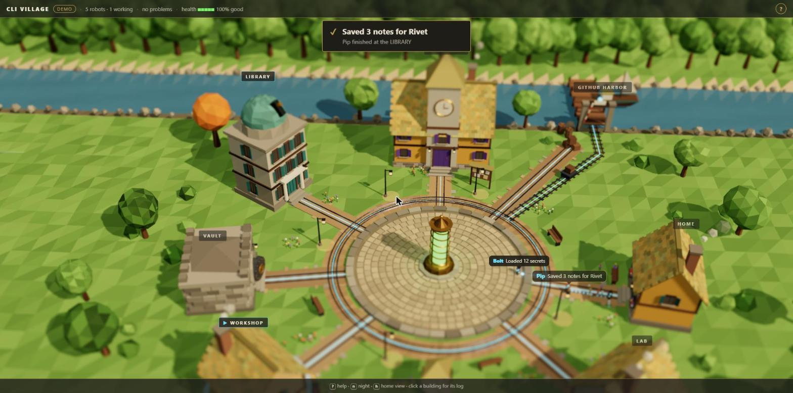
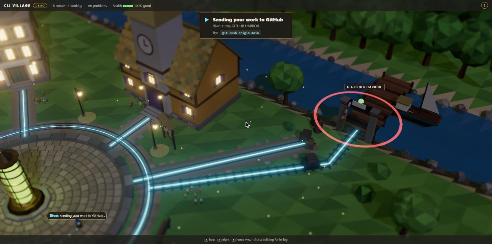

# CLI Village

> Watch your agents work in a tiny low-poly village.

CLI Village is a friendly, open-source wrapper around the [Infisical CLI](https://infisical.com/docs/cli/overview). It keeps everything Infisical does, including its privacy guarantees, and lets you *see* the work happening. Each agent is a little robot, each building is a type of task, and commits get carried down to the GitHub Harbor.

It's made for beginners (every action is explained in plain English, next to the real command) and stays out of the way for experts.

**Status:** early days, step 4 of 9. You can check your setup with `doctor`, watch a demo in the terminal with `--demo`, and watch it in a 3D village with `open --demo`.



## What you need

- Node.js 22 or newer
- git
- The Infisical CLI (`cli-village doctor` tells you how to install it)

## Try it (from source)

```bash
git clone https://github.com/GrantVRP/cli-village.git
cd cli-village
npm install      # download the packages CLI Village uses
npm run build    # turn the TypeScript in src/ into JavaScript in dist/
npm run doctor   # check your setup
npm run demo     # watch pretend robots work (Ctrl+C to stop)
npm run village  # the same demo, in the 3D village in your browser
```

Want to type `cli-village` from any folder? Run `npm link` once inside the project folder.

## Commands

| Command | What it does |
|---|---|
| `cli-village doctor` | Checks Node.js, git, the Infisical CLI, your Infisical login and your project link. Add `--json` for scripts. |
| `cli-village --demo` | Pretend robots act out a workday (nothing real runs) in the live terminal view. Add `--once` to play one round, `--speed 2` to go faster, or `--json` for one JSON event per line. |
| `cli-village open --demo` | Opens the 3D village in your browser and plays the demo there (the terminal keeps its own view). Add `--no-open` to just print the address, `--port 4317` to pick the port, or `--speed 2`. |

## The terminal view

```
CLI VILLAGE · demo                       5 robots · 1 working · no problems · health ■■■■■ 100% good
──────────────────────────────────────────────────────────────────────────────────────────────
  ▶ Fetching dev secrets
    Bolt at the VAULT · Reading secret names (values stay hidden) (60%)
    → infisical export --env=dev --format=json (the real command)
──────────────────────────────────────────────────────────────────────────────────────────────
Robots                                  │ What's happening (summary)
▶ Bolt   VAULT      Fetching dev secrets │ 17:11:50 ▶ Bolt started: Fetching dev secrets
○ Mayor  HOME       resting              │ 17:11:50 ✔ Mayor done: Jobs handed out
──────────────────────────────────────────────────────────────────────────────────────────────
q quit · ? what do the buildings mean? · d more detail
```

- The one thing that matters most right now is at the top, with the real command under it.
- Problems turn the message red (with a ✖, so it doesn't rely on color) until they're fixed.
- Keys: `q` quit (robots walk home first), `?` explains each building, `d` shows every detail.
- No interactive terminal (a pipe, CI)? You get a plain log instead. `NO_COLOR` is respected.

## The 3D village

`cli-village open --demo` starts a small web server on your own computer and opens the village in your browser. Your terminal shows the address. It looks like `http://127.0.0.1:53021/?token=…`, and only works on this computer.

- Each robot is an agent. When it starts a task it walks to that kind of building: secrets → VAULT, research → LIBRARY, code → WORKSHOP, tests → LAB, planning → TOWN HALL, commits and pushes → GITHUB HARBOR. Idle robots rest at HOME.
- Busy buildings send up cyan rings. Problems glow red and get a ✖ on their label.
- The glass column in the plaza shows the village's health: green → yellow → orange → red.
- The camera drifts slowly and glides to wherever the most important thing is happening. The caption at the top says what that is (and the real command).
- **Drag** to look around, **scroll** to zoom, **click** a building to see its log. Keys: `?` help, `n` night, `h` back to the whole village, `Esc` close.
- If your system asks for less motion (*reduce motion*), the camera stops drifting and wind effects are turned off.

| Night | A building's log |
|---|---|
|  |  |

Everything is built from simple shapes in code (no image textures) with [three.js](https://threejs.org/). The page loads nothing from the internet.

## How it works

Everything that happens is an **event**: `start`, `move`, `progress`, `done`, `fail`, `commit` or `push`. Workers, the demo and (later) outside AI agents send events into one stream, and every view listens to that same stream.

Before any view sees an event, a privacy guard checks it. The guard keeps only known fields, strips terminal control codes, and hides anything that looks like a secret: values Infisical gave us, `KEY=value` text, passwords and tokens. Secret lists may only contain key **names**.

## Privacy promises

- Secret **values** never appear in any view, event or log. Only key names and counts.
- Logging in is handled by Infisical itself (`infisical login` or `INFISICAL_TOKEN`). CLI Village never stores tokens.
- The village server only listens on your own computer (`127.0.0.1`). Each session gets a new random key, which must be in the page address and on the live connection. Requests from other websites are refused, and the page makes no outside calls.
- Secrets are never written to disk unless you ask for it (`--out .env`).

## Roadmap

- [x] 1. Scaffold + `doctor`
- [x] 2. Event bus + `--demo` mode
- [x] 3. Terminal view
- [x] 4. 3D village
- [ ] 5. Vault (real Infisical commands)
- [ ] 6. Beginner explainer + expert flags
- [ ] 7. GitHub Harbor with the secret-scan checkpoint
- [ ] 8. Library + external-agent event API
- [ ] 9. Tests + CI

## License

[MIT](LICENSE)
