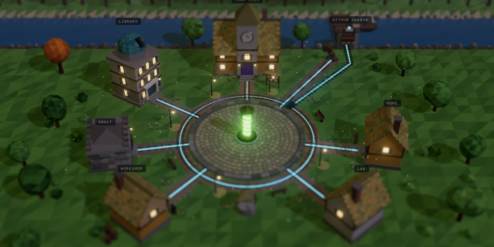
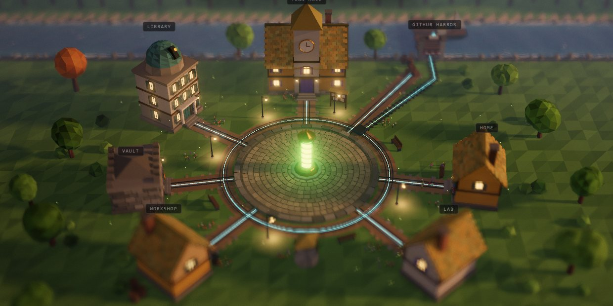
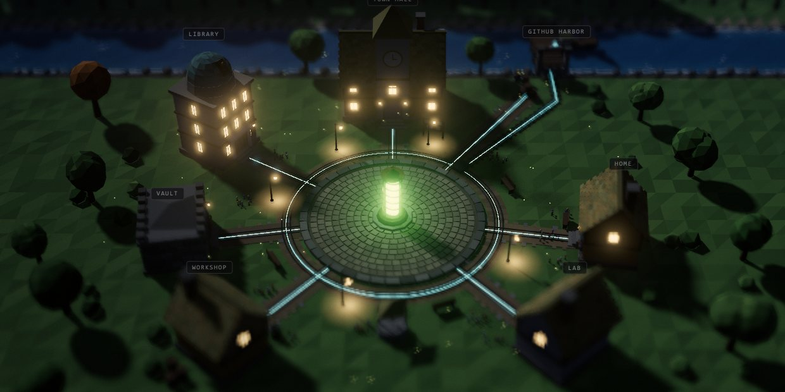

# How the village is drawn

The 3D village is a low-poly miniature: flat-shaded shapes with a colour per face, no image textures, built in code with [three.js](https://threejs.org/) (WebGL 2). The look comes from lighting and post-processing, so all of it lives in `web/src/render/`. Each file starts with a comment saying what it does and why.

## Before and after

The same village, the same colours and the same camera, before and after the new renderer (High quality, still mode).

| | Before | After |
|---|---|---|
| Day |  |  |
| Dusk (the app's default) |  |  |
| Night |  |  |

## Keeping the look

The new light must not change what the village looks like, only how well it's lit. So:
- Every colour from the art direction in `PROMPT.md` is unchanged. Only light, glow strength and post-processing were tuned.
- Dusk stays cool and dim, so the glowing rails and column carry the picture, as they did before.
- Things that glow (the rails, the column's fill) have dark surfaces. Their colour comes from their glow, so a bright sun can't wash it out to white.
- The rails' glow is divided by the exposure, so after tone mapping they're exactly as bright as before, at every time of day.
- The colour grade leaves strongly coloured pixels alone, so the cyan and green keep their hue.

## One frame

```
ScenePass        sky dome, then the scene → multisampled HDR target (half float) + depth texture
GTAOPass         ambient occlusion in creases and corners, from the   (High only)
                 scene's own depth (so it sways with the trees)
AtmospherePass   distance haze + height fog, from the depth buffer
DepthOfFieldPass circle of confusion → half-res bokeh gather → composite
UnrealBloomPass  glow around anything brighter than white             (Medium, High)
OutputPass       ACES tone mapping, linear → sRGB
FinishPass       colour grade, vignette, film grain, dithering
```

Everything up to the tone mapping is linear HDR, so the fog, the blur and the glow mix light the way light mixes. Nothing is drawn while the village is hidden (the desktop app's test checks for zero draw calls behind another tab).

## Light over the day (`timeline.ts`)

A day is one number, `k`: 0 is midday, 0.85 is dusk (the desktop app's default: a low warm sun under a cool sky), 1 is night. Four keyframes hold every value that depends on it:
- the sun's height, direction, colour and strength;
- the sky's zenith, horizon and glow;
- the fill light;
- the haze colour and density;
- the exposure, the lamps, the stars, the clouds, and the final saturation (eyes see less colour in the dark).

Colours are blended in linear light, and keyframes are eased with smoothstep, so nothing changes speed suddenly. Between sunset and night the sun hands over to the moon. The direct light dips through the swap, so shadows never visibly swing across the village. `test/render.test.mjs` walks the whole day in 1,000 steps and fails if any value jumps.

## Soft shadows (`shadows.ts`)

These are percentage-closer soft shadows (PCSS, Fernando 2005): sharp where a post meets the ground, softer the further the shadow falls. For each pixel:

1. **Blocker search.** It samples the shadow map over a Vogel (golden-angle) disc, plus the centre so thin posts are never missed, and averages the depth of whatever lies between the pixel and the sun.
2. **Penumbra estimate.** The width is (receiver depth − blocker depth) × the sun's angular size.
3. **Filtering.** It averages comparisons over a disc of that width. Each tap is a bilinear 2×2 comparison, done by hand, so edges stay smooth with few samples.

The disc is rotated per pixel by interleaved gradient noise (Jimenez 2014), which leaves no visible pattern.

three.js samples every shadow map in one shader chunk. `withSoftShadows()` replaces only the "basic" lookup and leaves the PCF and VSM paths alone. It finds the lookup by its signature and its braces, not by a comment, because three.js's published build strips comments. It refuses to patch a chunk it doesn't recognise. The unit test runs it against the real chunk of the installed three.js, so an upgrade that changes the shader fails a test instead of drawing wrong shadows.

The sun's shadow camera follows the sun. The light's `radius` is computed from a 2.6° sun, wider than the real one (0.53°), for the soft light of a hazy day.

## Sky and reflections (`sky.ts`)

The sky is a dome drawn at the far plane (`gl_Position = p.xyww`), coloured entirely in its shader:
- a gradient from horizon to zenith;
- a sun disc with a tight halo and a wide glow;
- clouds from five octaves of value noise, lit on the sun's side;
- stars, one per cell of a grid on the sky, that twinkle and hide behind clouds.

On Medium and High, the same dome is rendered into a prefiltered environment map (PMREM). The scene's materials then pick up the sky's real colour as soft ambient light. It's rebuilt only when the light has changed noticeably, at most every 0.4 seconds while the light fades, and never while the village is hidden.

## Haze and mist (`passes.ts`, AtmospherePass)

One full-screen pass rebuilds each pixel's world position from the depth buffer. Two kinds of fog are added up:
- **Haze** grows with distance past a starting point.
- **Mist** has a density that falls off exponentially with height. It's integrated along the view ray in closed form, so there is no ray marching. The integral is written with both exponents ≤ 0, so it can't overflow however long the ray.

The fog takes the sun's colour when you look towards the sun (forward scattering). Past the edge of the land it's all haze, so the world never ends in a visible line.

## Depth of field (`passes.ts`, DepthOfFieldPass)

This is a real lens blur, not the classic tilt-shift bands. The focus is the distance to what the camera looks at, so the village (or the building it's visiting) is sharp, and nearer and farther things blur.

1. **Circle of confusion.** It follows the thin-lens model: proportional to 1 − focus / distance, and signed, so it also says which of two pixels is nearer. Each pixel stores it next to its colour at half resolution. The prepare step takes the nearest of the four full-resolution depths, so thin near things keep their blur.
2. **Gather.** It samples a golden-angle spiral. A sample counts if its own blur reaches this pixel. Samples behind the pixel may spread only as far as its blur, so a sharp object never gets a halo from the background. Blurred foreground spreads freely, like a real lens. Bright samples weigh more, so lamps open into round bokeh discs.
3. **Composite.** It blends back over the sharp full-resolution picture, by this pixel's blur and by how much out-of-focus foreground covers it.

Close up, the blur eases off, so the neighbours of the building in view stay readable. `?debug=dof`, `dof-coc` and `dof-blend` show the blur size and blend.

## River (`water.ts`)

The river uses three.js's standard (PBR) material, so the sun, shadows and fill light treat it like everything else. Shader code is added for five things:
- **Waves.** Three sines move with the current in the vertex shader, and their slopes are exact derivatives, so the lighting follows them.
- **Ripples.** Two noise layers whose gradients scroll at different speeds tilt the normal per pixel, which breaks the sun into glints.
- **Sky reflection.** Schlick's fresnel term reflects the sky's colour along the reflected ray (about 2% straight down, much more at grazing angles).
- **Shallows.** The water is lighter towards the banks.
- **Foam.** A broken line of foam drifts along each bank. It comes from the distance to the bank, so there's no extra depth pass.

It replaced a per-frame CPU update of every vertex.

## Wind (`wind.ts`)

Trees are merged into one mesh with everything else that doesn't move, which keeps draw calls low. So the wind is a smooth function of world position, applied in the vertex shader:
- a crown's vertices move almost together, so it sways as one piece;
- slow gusts roll across the field;
- higher vertices move more, and trunks and the ground don't move.

The shadow pass uses a depth material with the same displacement, so shadows sway with the trees. Flat shading takes its normals from screen-space derivatives, so the lighting follows the moved faces for free.

## Finish (`passes.ts`, FinishPass)

This pass runs after tone mapping:
- an ASC CDL grade (slope, offset, power) and saturation;
- split toning (cool shadows, warm highlights), normalised so it doesn't darken;
- a soft vignette that follows the window's shape;
- film grain, strongest in the midtones;
- dithering by half an 8-bit step, so the sky's gradients never band.

It uses no lookup-table image (the page loads no textures).

## Quality tiers (`quality.ts`)

| | Low | Medium | High |
|---|---|---|---|
| Pixel ratio up to | 1 | 1.5 | 2 |
| Multisampling | off | 4× | 4× |
| Shadows | 2048², built-in PCF | 2048², PCSS 12 taps | 4096², PCSS 20 taps |
| Sky reflections | – | ✓ | ✓ |
| Ambient occlusion | – | – | ✓ |
| Bloom | – | ✓ | ✓ |
| Bokeh samples | 12 | 24 | 48 |

The starting tier comes from the graphics card's name (`WEBGL_debug_renderer_info`):
- software renderers (SwiftShader, llvmpipe, WARP, Microsoft Basic Render) start on Low;
- graphics built into the processor start on Medium;
- graphics cards and Apple silicon start on High.

After that, `FrameBudget` watches frame times. It ignores the first frames, while shaders compile, and judges the median of 90 frames, so one hitch doesn't count. It also ignores the frame after a sky-reflection rebuild and time spent hidden. It only ever steps down, so the picture never flickers between two tiers. Each step down frees the previous tier's render targets.

The page shows its average frame time in `data-frame-ms` on the `<html>` element. `?budget=1` makes every frame count as slow, to watch the step-down happen: High → Medium → Low in a few seconds.

The PCSS sample count is fixed when the page starts, because changing it later would mean recompiling every material. `?quality=` in the address (or View › Graphics Quality in the desktop app) fixes a tier and turns off the automatic step-down.

## Tested

- `test/render.test.mjs` (no graphics card needed):
  - the quality detection and frame budget;
  - the light over the day (endpoints, continuity, clamping, linear-light blends);
  - the soft-shadow patch against the installed three.js.
- `test/app/app.test.mjs` opens the desktop app. It switches through every graphics quality, checks that each one draws and logs no shader errors, and reports each tier's frame time. On CI's machines, which have no graphics card, that's the only way the Medium and High shaders get compiled. `CLI_VILLAGE_TEST_NO_GPU=1` reproduces that locally (there, Low takes about 37 ms a frame and Medium about 58 ms).
- Seen only on Windows (Direct3D 11 through ANGLE) so far, with an RTX 3080 and with Microsoft's software renderer. macOS and Linux run the same shaders through CI's app test, but nobody has looked at the picture there yet.
