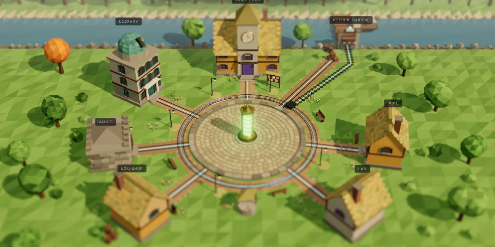
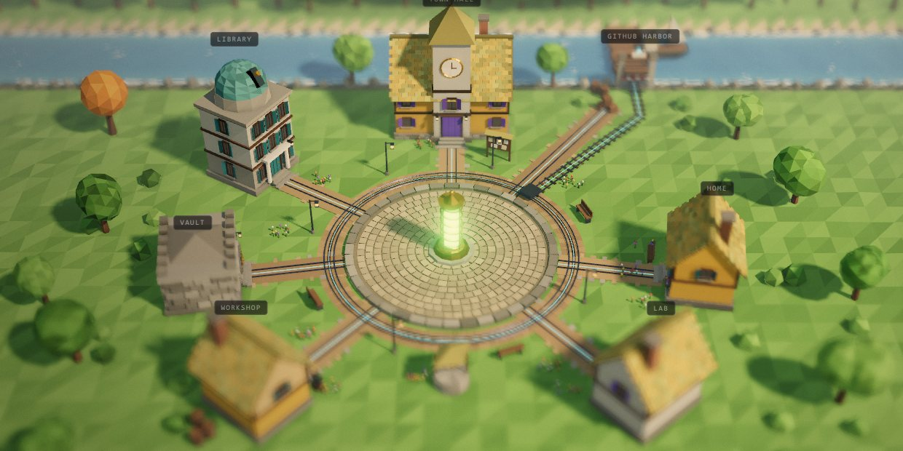
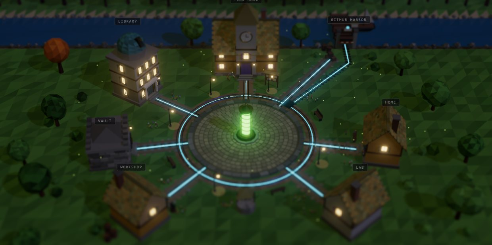

# How the village is drawn

The 3D village is a low-poly miniature: flat-shaded shapes with a colour per face, no image textures, built in code with [three.js](https://threejs.org/) (WebGL 2). The look comes from lighting and post-processing, so all of it lives in `web/src/render/`. Each file starts with a comment saying what it does and why.

## Before and after

The same village, the same colours and the same camera, before and after the new renderer (High quality, still mode).

| | Before | After |
|---|---|---|
| Day |  |  |
| Dusk (the app's default) |  |  |
| Night |  |  |

## Keeping the look

The new light must not change what the village looks like, only how well it's lit. So:
- Every colour from the art direction in `PROMPT.md` is unchanged. Only light, glow strength and post-processing were tuned.
- Dusk stays cool and dim, so the glowing rails and column carry the picture, as they did before.
- Things that glow (the rails, the column's fill) have dark surfaces. Their colour comes from their glow, so a bright sun can't wash it out to white.
- The rails' glow is divided by the exposure, so after tone mapping they're exactly as bright as before, at every time of day.
- The colour grade leaves strongly coloured pixels alone, so the cyan and green keep their hue.

## One frame

```
ScenePass        sky dome, then the scene → multisampled HDR target (half float) + depth texture
GTAOPass         ambient occlusion in creases and corners, from the   (High only)
                 scene's own depth (so it sways with the trees)
AtmospherePass   distance haze + height fog, from the depth buffer
DepthOfFieldPass circle of confusion → half-res bokeh gather → composite
UnrealBloomPass  glow around anything brighter than white             (Medium, High)
OutputPass       ACES tone mapping, linear → sRGB
FinishPass       colour grade, vignette, film grain, dithering
```

Everything up to the tone mapping is linear HDR, so the fog, the blur and the glow mix light the way light mixes. Nothing is drawn while the village is hidden (the desktop app's test checks for zero draw calls behind another tab).

## Light over the day (`timeline.ts`)

A day is one number, `k`: 0 is midday, 0.85 is dusk (the desktop app's default: a low warm sun under a cool sky), 1 is night. Four keyframes hold every value that depends on it:
- the sun's height, direction, colour and strength;
- the sky's zenith, horizon and glow;
- the fill light;
- the haze colour and density;
- the exposure, the lamps, the stars, the clouds, and the final saturation (eyes see less colour in the dark);
- `moon`: how much of the light is the moon's, 0 until sunset and 1 at night. It turns on what only the night has: the night sky's shape and stars, night vision in the finish pass, a less blurred sky, and softer glints on the river. Day and the dusk default never see it (a test checks).

Colours are blended in linear light, and keyframes are eased with smoothstep, so nothing changes speed suddenly. Between sunset and night the sun hands over to the moon. The direct light dips through the swap, so shadows never visibly swing across the village. `test/render.test.mjs` walks the whole day in 1,000 steps and fails if any value jumps.

## The night

The night was designed from how film, painting and games show moonlight:
- **Moonlight isn't blue.** It's reflected sunlight. Night looks blue because in the dark the eye switches to its rods, which see less colour and are most sensitive to blue-green (the Purkinje shift). Film's "day for night" copies this: darker, bluer, with lamps left warm. So the moon here is a low-colour blue-grey, and the blue comes from night vision (below).
- **Never black, and shadows keep their shape.** Moonlight to fill light is about 4:1, not 9:1, and the ground bounces a little warm plum light back up, so shadows read as cool and soft, not as holes. (James Gurney's moonlight studies: low colour, unified shadows, not too dark, warm accents.)
- **Warm against cool.** Lamps and windows are the only warm, bright things, so they lead the eye. Nothing else is allowed to compete with them.
- **Depth.** The haze lightens with distance, and a thin glow sits on the horizon, so roofs and trees stand out against the sky.
- **The moon behind the river.** From the usual view, its light glitters on the water instead of being off-screen.

Sources: [day for night](https://en.wikipedia.org/wiki/Day_for_night), [mesopic vision](https://en.wikipedia.org/wiki/Mesopic_vision), [Gurney on moonlight](https://gurneyjourney.blogspot.com/2020/07/seven-tips-for-painting-moonlight.html), [Patry, "Real-Time Samurai Cinema" (Ghost of Tsushima), SIGGRAPH 2021](https://advances.realtimerendering.com/s2021/jpatry_advances2021/index.html), and [stars in a game sky](https://frozenfractal.com/blog/2026/7/21/around-the-world-32-its-full-of-stars/).

## Soft shadows (`shadows.ts`)

These are percentage-closer soft shadows (PCSS, Fernando 2005): sharp where a post meets the ground, softer the further the shadow falls. For each pixel:

1. **Blocker search.** It samples the shadow map over a Vogel (golden-angle) disc, plus the centre so thin posts are never missed, and averages the depth of whatever lies between the pixel and the sun.
2. **Penumbra estimate.** The width is (receiver depth − blocker depth) × the sun's angular size.
3. **Filtering.** It averages comparisons over a disc of that width. Each tap is a bilinear 2×2 comparison, done by hand, so edges stay smooth with few samples.

The disc is rotated per pixel by interleaved gradient noise (Jimenez 2014), which leaves no visible pattern.

three.js samples every shadow map in one shader chunk. `withSoftShadows()` replaces only the "basic" lookup and leaves the PCF and VSM paths alone. It finds the lookup by its signature and its braces, not by a comment, because three.js's published build strips comments. It refuses to patch a chunk it doesn't recognise. The unit test runs it against the real chunk of the installed three.js, so an upgrade that changes the shader fails a test instead of drawing wrong shadows.

The sun's shadow camera follows the sun. The light's `radius` is computed from a 2.6° sun, wider than the real one (0.53°), for the soft light of a hazy day.

## Sky and reflections (`sky.ts`)

The sky is a dome drawn at the far plane (`gl_Position = p.xyww`), coloured entirely in its shader:
- a gradient from horizon to zenith;
- a sun disc with a tight halo and a wide glow;
- clouds from five octaves of value noise, lit on the sun's side;
- stars, one per cell of a grid on the sky, that twinkle and hide behind clouds.

At night (`moon`) the dome changes shape: a thin glow along the horizon, a deep slate-blue middle (`skyMid`), and the darkest blue straight up. Night stars are round dots, placed anywhere in their cell: many faint ones and a few bright ones, pale blue to warm white, a couple of pixels wide so they don't shimmer, and fainter near the horizon, as through more air. A faint Milky Way is a band of domain-warped noise with darker dust in it. All of this is skipped by day and in the environment map, and only runs for pixels that look above the horizon.

On Medium and High, the same dome is rendered into a prefiltered environment map (PMREM). The scene's materials then pick up the sky's real colour as soft ambient light. It's rebuilt only when the light has changed noticeably, at most every 0.4 seconds while the light fades, and never while the village is hidden.

## Haze and mist (`passes.ts`, AtmospherePass)

One full-screen pass rebuilds each pixel's world position from the depth buffer. Two kinds of fog are added up:
- **Haze** grows with distance past a starting point.
- **Mist** has a density that falls off exponentially with height. It's integrated along the view ray in closed form, so there is no ray marching. The integral is written with both exponents ≤ 0, so it can't overflow however long the ray.

The fog takes the sun's colour when you look towards the sun (forward scattering). Past the edge of the land it's all haze, so the world never ends in a visible line.

## Depth of field (`passes.ts`, DepthOfFieldPass)

This is a real lens blur, not the classic tilt-shift bands. The focus is the distance to what the camera looks at, so the village (or the building it's visiting) is sharp, and nearer and farther things blur.

1. **Circle of confusion.** It follows the thin-lens model: proportional to 1 − focus / distance, and signed, so it also says which of two pixels is nearer. Each pixel stores it next to its colour at half resolution. The prepare step takes the nearest of the four full-resolution depths, so thin near things keep their blur.
2. **Gather.** It samples a golden-angle spiral. A sample counts if its own blur reaches this pixel. Samples behind the pixel may spread only as far as its blur, so a sharp object never gets a halo from the background. Blurred foreground spreads freely, like a real lens. Bright samples weigh more, so lamps open into round bokeh discs.
3. **Composite.** It blends back over the sharp full-resolution picture, by this pixel's blur and by how much out-of-focus foreground covers it.

Close up, the blur eases off, so the neighbours of the building in view stay readable. At night the sky is blurred much less, so stars stay points of light instead of opening into blurred shapes. `?debug=dof`, `dof-coc` and `dof-blend` show the blur size and blend.

## River (`water.ts`)

The river uses three.js's standard (PBR) material, so the sun, shadows and fill light treat it like everything else. Shader code is added for five things:
- **Waves.** Three sines move with the current in the vertex shader, and their slopes are exact derivatives, so the lighting follows them.
- **Ripples.** Two noise layers whose gradients scroll at different speeds tilt the normal per pixel, which breaks the sun into glints.
- **Sky reflection.** Schlick's fresnel term reflects the sky's colour along the reflected ray (about 2% straight down, much more at grazing angles).
- **Shallows.** The water is lighter towards the banks.
- **Foam.** A broken line of foam drifts along each bank. It comes from the distance to the bank, so there's no extra depth pass.

It replaced a per-frame CPU update of every vertex.

## Wind (`wind.ts`)

Trees are merged into one mesh with everything else that doesn't move, which keeps draw calls low. So the wind is a smooth function of world position, applied in the vertex shader:
- a crown's vertices move almost together, so it sways as one piece;
- slow gusts roll across the field;
- higher vertices move more, and trunks and the ground don't move.

The shadow pass uses a depth material with the same displacement, so shadows sway with the trees. Flat shading takes its normals from screen-space derivatives, so the lighting follows the moved faces for free.

## Nature details (`nature.ts`)

Grass, wildflowers, mossy boulders, reeds and garden fences, placed from their own random numbers (so nothing else in the village moves) and kept clear of the plaza, paths, rails, buildings, props, trees and river. Grass grows in patches, thicker where a smooth "lushness" pattern says so, and along the edges where nobody walks: beside the paths and round the buildings' feet.

On Medium and High a second layer of grass, with its own random numbers, fills the meadows out: about 30,000 more blades on top of the first 16,000, so three times the grass. Low keeps only the first, so the rest of the village is the same either way.

Three tricks keep the tens of thousands of blades cheap and in the style:
- **Blades go straight into one buffer.** A blade is a thin three-sided spike, three triangles, darker at the root and lighter at the tip, written as numbers. With a shape object and a matrix per blade, building the grass took over half a second at start-up.
- **Grass is lit as if it faced up**, like the ground it grows from. Thin blades lit by their own steep faces look dark from above.
- **The tiny things (grass and pebbles) don't write depth** and are drawn after the other solid things, so everything still hides them correctly, but ambient occlusion, depth of field and the haze see the ground under them, as they would a decal. Otherwise the occlusion finds a crease round every blade and turns the grass black. They cast no shadows either: theirs would be too small to see.

Boulders, reeds and fences are merged with the rest of the village (no extra draw calls) and cast shadows; reeds sway with the trees.

**Flowers** (`flora.ts`) are little plants, not dots: a rosette of leaves, a stem with a leaf on it, and a head made for its kind. Daisies and cosmos have petals round a centre, poppies five cupped petals round a dark middle, tulips a closed cup, lavender a spike of buds. They go in three places:
- **Beds** round the plaza and by the cottages: a patch of dark soil with a soft, uneven edge, flowers on a loose staggered grid. A bed goes in a gap between paths, and is placed with its whole width clear of the well and the notice board. Any flower that would land within 1.45 of a path is left out (`distanceToPaths` and `roomFromProps` in `layout.ts`), so nothing grows where the robots walk.
- **Window boxes:** a low leafy mound with seven small blooms.
- **The meadows:** the wildflower patches, mostly one kind to a patch, in a lighter version (fewer leaves and petals), since there are about 300 of them.

Flowers are solid, write depth and cast shadows, merged into the village's meshes. In winter the flowers are over and snowdrops come up in the beds and window boxes instead: clumps of two to four stems, each with two narrow grey-blue leaves (a colour winter's look leaves alone; it turns brighter greens to straw) and a white flower nodding from a little arch. The flowers' heads, their leaves and stems, and the snowdrops each have a material of their own, so the seasons swap them all at once (`showWinterFlowers`). A hidden material isn't drawn, so the snowdrops cost nothing in summer and the flowers nothing in winter. They have their own random numbers, and the old flowers' random numbers are still drawn, so no rock, tuft or tree moved. They cost triangles rather than draws: the home view went from about 570,000 to 735,000 triangles a frame (counting the shadow and depth passes), and three more draw calls on High (one on Low) for those materials. Measured on this PC with the cap off, at the dusk the app opens with, against the version before them: High went up by about 0.2 ms a frame (from about 4.0 to 4.2); on Low the difference was lost in the noise (1.5 to 2.8 ms a frame either way).

## Weather and seasons (`weather.ts`, `weathering.ts`, `precipitation.ts`)

**What decides the weather** (`weather.ts`, plain numbers, tested):
1. The switch: `w`, View › Weather and Seasons in the desktop app, or `?weather=off`. Off is always a clear summer: the village exactly as it was before weather.
2. A pin for screenshots: `?weather=clear|cloudy|rain|storm|snow` and `?season=spring|summer|autumn|winter`.
3. The work: an unfixed problem brings cloud and steady rain; a secret stopped at the harbor gate brings a storm. Cloud gathers over a few seconds; once the problem is fixed it clears over about fifteen, like a shower passing.
4. A gentle drift, from the clock: clouds come and go over several minutes, now and then a light shower. Never more than that. In still mode the sky stays as it was when the page opened.

The work and the drift are combined by taking the stormier of the two, so the village never looks fairer than the work is. In winter, rain falls as snow.

**The season** comes from this computer's calendar, with no network and no location. The time zone only says which half of the world it's in, so July is summer in Ohio and winter in Sydney. Seasons blend over about two weeks around each change (1 March, 1 June, 1 September, 1 December in the north). Summer is the village as it was.

**The light** (`withWeather` in `timeline.ts`): cloud takes the sun's direct light and spreads it over the sky, as on an overcast day. The sun gets weaker and the fill stronger, colours go greyer and a little cooler, the haze thickens, and stars hide. A storm is darker still. Snow lying on the ground throws a little light back up. The sky's reflection is rebuilt when the cloud changes, as it is when the light does.

**The surfaces** (`weathering.ts`), added to the shaders of the materials the village already has, so nothing is rebuilt and there are no extra draw calls:
- **Cloud shadows:** soft-edged patches of shade drifting with the wind. Half cloud puts about half the land in shade.
- **Rain:** wet things go darker and glossier, and puddles gather on flat ground. Under thick cloud there's no sharp sun or moon to see in wet things or on the river, only the sky.
- **Snow:** white on every face that looks up (roofs, fields, the tops of trees and rocks), with ragged edges, and trodden off the plaza, the paths and the rails. Grass comes up out of it as straw. A little snow lies in patches, like a first snowfall (around 1 December, as autumn turns to winter); more joins the patches up.
- **Seasons:** spring brings fresher greens and pink blossom on about a third of the trees. In autumn, stands of trees turn gold, orange or red together (a slow pattern across the land picks which), and the grass goes golden. Winter dulls the greens. Only green things change: the shader picks them by colour.
- **Robots** stay as they are in any weather (no snow on their heads, no autumn tint): they get their own copies of the shared materials, which the weather leaves alone (`keepDry`).

The world position each effect uses is taken before the wind moves the leaves, so the patterns stay put on a swaying tree. Every effect is zero in a clear summer, and then the shaders work out exactly the colours they did before.

**Falling things** (`precipitation.ts`): rain as thin streaks, snow as soft dots, and in autumn leaves drifting down. Each is made once, with room for the most it will ever show, and moved entirely on the graphics card from the time and a few random numbers per drop. One layer covers the village; a second, near the camera, has bigger drops that are softly out of focus, like rain past a lens. Snowflakes fade right in front of the lens. With reduced motion nothing falls: the wet ground, the snow and the grey light still show the weather.

Measured on this PC with the frame-rate cap off, alternating clear weather, storm and snow over two rounds: weather made no difference bigger than the run-to-run noise. On High that noise is about a millisecond: weather off 7.1 ms a frame, snow 6.1, storm 7.1. Low took about 1.7 ms with any weather, Medium 2.7 to 3.2. Automatic stayed on High in a storm.

## Village life (`life.ts`, `reactions.ts`)

Things that aren't about the work, so the village feels lived in. Who is out when is decided in `life-rules.ts` (plain numbers, tested):

| | Out when | Gone |
|---|---|---|
| Birds | day and dusk | when it's nearly dark; they fly off in rain or snow |
| Butterflies | spring and summer days (fewer in autumn) | winter, rain, snow, after sunset |
| Fireflies | evenings and nights, already at the dusk the app opens with | winter, rain, snow |
| Villagers and the fisherman | day and dusk (lanterns lit at dusk) | night, rain, snow: they go indoors |
| The cat | day and dusk | asleep on its bench at night and in rain |

- **Birds:** a loose flock on one slow circle over the town hall and the river, flapping in bursts, then gliding. Drawn half again as big as life so they read from the home view. The circle is set back so the whole flock stays near the home view's focus distance: birds nearer the camera turned into blurred smudges over the plaza. They cast no shadows: from that height a bird's shadow is only a dark fleck on the ground.
- **Butterflies** visit the real wildflower patches (`nature.ts` tells `life.ts` where they are). **Fireflies** are points that each blink on their own, along the meadows and the river bank.
- **On the river:** ducks paddle by the near bank upstream of the library, where the home view sees open water, round a loop like a running track (two straight runs joined by wide half circles) at an even speed, a duck's length apart (round a thin ellipse at an even angle they bunched up at its sharp ends and swam into each other); the fisherman drifts down the far bank for about 80 seconds, turns, rows back up and turns again; at night the boat is tied to a post. He keeps close in to the far bank, so the float and the oars stay clear of the boats' lane. From the home view the ducks and the rowboat are small; they're for when you look closer.
- **The cat and villagers** keep to their own spots (two benches, the well, a flower patch, a sunny spot in the meadow), away from the robots' paths and doors. The cat has a model for each pose rather than one model bent into all of them: sitting up on the bench with its tail round its paws, walking, lying in the sun like a loaf, and curled up asleep, eyes shut, its tail round to its nose. It hops down in front of the seat and back up in an arc, and walks to its sunny spot round the bench's end and through the gap between the two flower beds behind it: straight there, it walked under the seat and through a bed. The villager who picks flowers tends the bed nearest the bench, standing just off its soil rather than in it (`addBed` returns where each bed's soil lies).
- **The windmill** (`world.ts`) stands in a clearing in the tree line on the far bank. The trees that stood there are still made, into a builder that's thrown away, so they use up the same random numbers and no other tree moves.
- **One wind** (`breeze` in `life-rules.ts`): 1 on a fair day, so the trees sway as before, up to 1.7 in a storm. The trees, the flags (`flag.ts`), the chimney smoke and the windmill's sails all follow it. The flags' wave adds up its phase over time, so a change in the wind never makes it jump.
- **Hearth fires** (`hearthFires`): lit at dusk and in winter (half of them in autumn), so chimneys puff more often and the smoke lasts longer. A winter evening has about three times the smoke of a summer day.
- **Robots react** (`reactions.ts`, tested): only to what happens from now on, never to the history a page catches up on. A cheer beats a wave, and each robot reacts once.

Everything is seeded, so it looks the same every time, and everything follows still mode: one fixed pose, no smoke. Birds (a body and two wings), butterflies (two wings) and fireflies are instanced, so a few draws cover the whole flock whatever its size; Low draws 6 birds, 6 butterflies and 24 fireflies, Medium 9, 10 and 40, High 12, 14 and 64. The villagers, the cat, the ducks and the rowboat are small models of a few parts each: with their shadows they add about 80 draw calls. Measured on this PC with the cap off, at the dusk the app opens with, switching them off and on in the same run: on High the difference was inside the noise (3.7 to 3.8 ms a frame either way); on Low it was about 0.25 ms (1.55 against 1.3).

## Finish (`passes.ts`, FinishPass)

This pass runs after tone mapping:
- an ASC CDL grade (slope, offset, power) and saturation;
- split toning (cool shadows, warm highlights), normalised so it doesn't darken;
- night vision: at night, the darker and the less colourful a pixel, the more its colour gives way to the rods' slate blue, at the same brightness. Bright or strongly coloured light (the lamps, the status column, the rails) is left alone, so it keeps its colour and its meaning;
- a soft vignette that follows the window's shape;
- film grain, strongest in the midtones;
- dithering by half an 8-bit step, so the sky's gradients never band.

It uses no lookup-table image (the page loads no textures).

## Quality tiers (`quality.ts`)

| | Low | Medium | High |
|---|---|---|---|
| Pixel ratio up to | 1 | 1.5 | 2 |
| Multisampling | off | 4× | 4× |
| Shadows | 2048², built-in PCF | 2048², PCSS 12 taps | 4096², PCSS 20 taps |
| Sky reflections | – | ✓ | ✓ |
| Ambient occlusion | – | – | ✓ |
| Bloom | – | ✓ | ✓ |
| Bokeh samples | 12 | 24 | 48 |
| Extra grass | – | ✓ | ✓ |
| Raindrops, snowflakes | 2,200, 1,400 | 5,000, 3,000 | 9,000, 5,000 |

The starting tier comes from the graphics card's name (`WEBGL_debug_renderer_info`):
- software renderers (SwiftShader, llvmpipe, WARP, Microsoft Basic Render) start on Low;
- graphics built into the processor start on Medium;
- graphics cards and Apple silicon start on High.

After that, `FrameBudget` watches frame times. It ignores the first frames, while shaders compile, and judges the median of 90 frames, so one hitch doesn't count. It also ignores the frame after a sky-reflection rebuild and time spent hidden. It only ever steps down, so the picture never flickers between two tiers. Each step down frees the previous tier's render targets.

The page shows its average frame time in `data-frame-ms` on the `<html>` element. `?budget=1` makes every frame count as slow, to watch the step-down happen: High → Medium → Low in a few seconds.

The PCSS sample count is fixed when the page starts, because changing it later would mean recompiling every material. `?quality=` in the address (or View › Graphics Quality in the desktop app) fixes a tier and turns off the automatic step-down.

## Tested

- `test/render.test.mjs` (no graphics card needed):
  - the quality detection and frame budget;
  - the light over the day (endpoints, continuity, clamping, linear-light blends);
  - the soft-shadow patch against the installed three.js;
  - the robots' reactions, and who in the village is out in which light, season and weather.
- `test/app/app.test.mjs` opens the desktop app. It switches through every graphics quality, checks that each one draws and logs no shader errors, and reports each tier's frame time. On CI's machines, which have no graphics card, that's the only way the Medium and High shaders get compiled. `CLI_VILLAGE_TEST_NO_GPU=1` reproduces that locally (there, Low takes about 37 ms a frame and Medium about 58 ms).
- Seen only on Windows (Direct3D 11 through ANGLE) so far, with an RTX 3080 and with Microsoft's software renderer. macOS and Linux run the same shaders through CI's app test, but nobody has looked at the picture there yet.
